<!--
  ┌──────────────────────────────────────────────────────────────────┐
  │  README of @abin0x · Mahmudul Hasan Abin                         │
  │  assets/hero.svg        animated dot-matrix banner               │
  │  assets/avatar-dots.svg profile photo rendered in dots           │
  └──────────────────────────────────────────────────────────────────┘
-->

<p align="center">
  
</p>

<p align="center">
  
</p>

<p align="center">
  <a href="https://abin0x.netlify.app"></a>
  <a href="https://www.linkedin.com/in/MahmudulHasanAbin"></a>
  <a href="https://twitter.com/abin0x"></a>
  <a href="https://instagram.com/abin0x"></a>
  <a href="https://youtube.com/@abin0x"></a>
  <a href="https://bento.me/abin0x"></a>
</p>

<p align="center">
  
  <a href="https://github.com/abin0x?tab=followers"></a>
  
</p>

---

## <samp>&gt;&nbsp;About Me</samp>

<p align="center">
  
</p>

<!--
  Two other cards are built and ready in assets/ — swap either one in here:
    assets/profile-card.svg   light card: typed bio, orbiting rings, the photo
                              dissolving into dots and back  (python assets/cardify.py)
    assets/avatar-dots.svg    just the portrait as a dot matrix  (python assets/dotify.py)
-->

I'm **Mahmudul Hasan Abin** — a Junior Python Developer studying at
**Hajee Mohammad Danesh Science and Technology University**, Dinajpur.

- 🐍 &nbsp;I build web applications with **Python, Django & Django REST Framework**
- 📱 &nbsp;I also work on **App Development** — building mobile apps and the APIs behind them
- 🧩 &nbsp;Strong foundation in **C, C++ and Data Structures & Algorithms**
- 🎨 &nbsp;Comfortable across the stack — **HTML, CSS, JavaScript, Bootstrap**
- 🗄️ &nbsp;Work daily with **PostgreSQL, MySQL, MongoDB, Supabase**
- 🏆 &nbsp;Solving problems on **Codeforces** and **LeetCode** as `abin0x`
- 🌱 &nbsp;Currently going deeper into **REST APIs, system design and AI**
- 💬 &nbsp;Ask me about **Python, Django or anything web & app**

<details>
<summary><samp><b>&nbsp;⚡ abin0x.py — run me</b></samp></summary>

```python
class Developer:
    def __init__(self):
        self.name       = "Mahmudul Hasan Abin"
        self.handle     = "abin0x"
        self.role       = "Junior Python Developer"
        self.university = "HSTU, Dinajpur"
        self.stack      = ["Python", "Django", "DRF", "JavaScript", "PostgreSQL"]
        self.focus      = ["Web Development", "App Development", "REST APIs"]
        self.learning   = ["System Design", "AI Engineering", "DSA"]

    def say_hello(self):
        return f"Hi, I am {self.name}. Let's build something together!"


if __name__ == "__main__":
    print(Developer().say_hello())
```

</details>

---

## <samp>&gt;&nbsp;What I Do</samp>

<table align="center">
<tr align="center">
<td width="25%">

### 🌐
**Web Development**

Responsive, database-driven websites built with Django and modern front-end tooling.

</td>
<td width="25%">

### 📱
**App Development**

Mobile applications backed by clean, well-documented REST APIs.

</td>
<td width="25%">

### 🔌
**API Development**

Secure, versioned APIs with Django REST Framework and PostgreSQL.

</td>
<td width="25%">

### 🧠
**Problem Solving**

Daily practice on Codeforces and LeetCode with C++ and Python.

</td>
</tr>
</table>

---

## <samp>&gt;&nbsp;Tech Stack</samp>

<table align="center">
  <tr>
    <td align="right" width="130"><b>Languages</b></td>
    <td></td>
  </tr>
  <tr>
    <td align="right"><b>Frameworks</b></td>
    <td>
      
      
    </td>
  </tr>
  <!-- 📱 App Development — swap in whatever you actually use, then delete this comment
  <tr>
    <td align="right"><b>App Dev</b></td>
    <td></td>
  </tr>
  -->
  <tr>
    <td align="right"><b>Databases</b></td>
    <td></td>
  </tr>
  <tr>
    <td align="right"><b>Tools</b></td>
    <td></td>
  </tr>
  <tr>
    <td align="right"><b>Deploy</b></td>
    <td>
      
      
      
      
    </td>
  </tr>
</table>

---

## <samp>&gt;&nbsp;GitHub Statistics</samp>

<div align="center">


<br><br>


<br><br>


<br><br>


</div>

---

## <samp>&gt;&nbsp;Featured Projects</samp>

<table>
<tr>
<td width="50%" valign="top">

### 📚 Library Management System


Manage book inventories, track lending history and handle member registration from one dashboard.

`Django` `Python` `JavaScript` `HTML` `CSS`

<a href="https://library0x.netlify.app/"></a>

</td>
<td width="50%" valign="top">

### 🎓 Online Course School


A learning platform where students enroll in courses, track progress and access course materials.

`Django` `Python` `JavaScript` `HTML` `CSS`

<!-- TODO: point this at the Online Course School demo — it currently reuses the library link -->
<a href="https://library0x.netlify.app/"></a>

</td>
</tr>
<tr>
<td width="50%" valign="top">

### 🏛️ University Management System


Student registration, course enrollment and academic performance tracking for a university.

`Django` `Python` `JavaScript` `HTML` `CSS`

<a href="https://hstu.netlify.app/"></a>

</td>
<td width="50%" valign="top">

### 💼 Personal Portfolio


My portfolio — a fully responsive, animated showcase of my work, skills and contact details.

`JavaScript` `HTML` `CSS`

<a href="https://abin0x.netlify.app/"></a>

</td>
</tr>
</table>

---

## <samp>&gt;&nbsp;Competitive Programming</samp>

<div align="center">

<a href="https://codeforces.com/profile/abin0x"></a>
&nbsp;
<a href="https://leetcode.com/abin0x"></a>

<br><br>


</div>

---

## <samp>&gt;&nbsp;Get in Touch</samp>

<div align="center">

**Open to internships, freelance work and collaboration on Python / Django and app projects.**

<a href="https://www.linkedin.com/in/MahmudulHasanAbin"></a>
<a href="https://bento.me/abin0x"></a>

<br><br>

<samp><i>"Write clean code, ship it, then make it better."</i></samp>

</div>

<!--
  Optional — contribution snake animation.
  Add the workflow from https://github.com/Platane/snk to .github/workflows/snake.yml,
  run it once, then uncomment:

  <picture>
    <source media="(prefers-color-scheme: dark)" srcset="https://raw.githubusercontent.com/abin0x/abin0x/output/github-snake-dark.svg">
    
  </picture>
-->


