<!--
  README of @abin0x · Mahmudul Hasan Abin

  Every card is a plain SVG in assets/, built by a script next to it:
    hero.svg, now.svg, orbit.svg, footer.svg   python assets/animated.py
    neofetch-card.svg                          python assets/neofetch.py
    stats-card.svg                             python assets/stats.py
    profile-card.svg, avatar-dots.svg          python assets/cardify.py / dotify.py (spare cards)
  The snake comes from .github/workflows/snake.yml (branch "output").
  The previous design is kept as the git tag readme-v1-2026-11-21.
-->

<p align="center">
  
</p>

<p align="center">
  <a href="https://abin0x.netlify.app"></a>
  <a href="https://www.linkedin.com/in/abin0x"></a>
  <a href="https://twitter.com/abin0x"></a>
  <a href="https://instagram.com/abin0x"></a>
  <a href="https://youtube.com/@abin0x"></a>
  <a href="https://bento.me/abin0x"></a>
</p>

<p align="center">
  
  <a href="https://github.com/abin0x?tab=followers"></a>
  
</p>

---

## <samp>&gt;&nbsp;About Me</samp>

<p align="center">
  
</p>

I'm **Mahmudul Hasan Abin** (`abin0x`), a **Software Engineer** and Computer Science & Engineering student at
**Hajee Mohammad Danesh Science and Technology University (HSTU)**, Dinajpur, Bangladesh.
I build intelligent software with Python & Django, explore AI and agentic development, and research what's next.

🌐 &nbsp;Portfolio, projects, research and blog: **[abin0x.netlify.app](https://abin0x.netlify.app)**

- 🐍 &nbsp;I build web applications and backends with **Python, Django & Django REST Framework**
- 🤖 &nbsp;Exploring **AI and agentic development**, and researching the future of software engineering
- 📱 &nbsp;I also work on **App Development**: mobile apps and the APIs behind them
- 🧩 &nbsp;Strong foundation in **C, C++ and Data Structures & Algorithms**
- 🎨 &nbsp;Comfortable across the stack: **HTML, CSS, JavaScript, Bootstrap, Next.js**
- 🗄️ &nbsp;Work daily with **PostgreSQL, MySQL, MongoDB, Supabase**
- 🏆 &nbsp;Solving problems on **Codeforces** and **LeetCode** as `abin0x`
- 💬 &nbsp;Ask me about **Python, Django, AI or anything web & app**

<details>
<summary><samp><b>&nbsp;⚡ abin0x.py: run me</b></samp></summary>

```python
class Developer:
    def __init__(self):
        self.name       = "Mahmudul Hasan Abin"
        self.handle     = "abin0x"
        self.role       = "Software Engineer"
        self.university = "HSTU, Dinajpur"
        self.portfolio  = "https://abin0x.netlify.app"
        self.stack      = ["Python", "Django", "DRF", "Next.js", "PostgreSQL", "Supabase"]
        self.focus      = ["Web Development", "App Development", "REST APIs", "AI"]
        self.learning   = ["System Design", "LLM APIs & AI Agents", "RAG & MCP", "DSA"]

    def say_hello(self):
        return f"Hi, I am {self.name}. Let's build something together!"


if __name__ == "__main__":
    print(Developer().say_hello())
```

</details>

---

## <samp>&gt;&nbsp;Right Now</samp>

<p align="center">
  
</p>

---

## <samp>&gt;&nbsp;What I Do</samp>

<table align="center">
<tr align="center">
<td width="25%">

### 🌐
**Web & App Development**

Responsive, database-driven web apps with Django and Next.js, and mobile apps on top of them.

</td>
<td width="25%">

### 🔌
**APIs & Backends**

Secure, versioned REST APIs with Django REST Framework, PostgreSQL and Supabase.

</td>
<td width="25%">

### 🤖
**AI & Agents**

Building with LLM APIs, AI agents, RAG and MCP, and researching where software is heading.

</td>
<td width="25%">

### 🧠
**Problem Solving**

Daily practice on Codeforces and LeetCode with C++ and Python.

</td>
</tr>
</table>

---

## <samp>&gt;&nbsp;Tech Stack</samp>

<p align="center">
  
</p>

<details>
<summary><samp><b>&nbsp;📋 the same stack as a list</b></samp></summary>
<br>

<table align="center">
  <tr>
    <td align="right" width="130"><b>Languages</b></td>
    <td></td>
  </tr>
  <tr>
    <td align="right"><b>Frameworks</b></td>
    <td>
      
      
    </td>
  </tr>
  <tr>
    <td align="right"><b>Databases</b></td>
    <td></td>
  </tr>
  <tr>
    <td align="right"><b>Tools</b></td>
    <td></td>
  </tr>
  <tr>
    <td align="right"><b>Deploy</b></td>
    <td>
      
      
      
      
    </td>
  </tr>
</table>

</details>

---

## <samp>&gt;&nbsp;GitHub Activity</samp>

<!--
  Self-hosted on purpose. The usual third-party cards (github-readme-stats and friends)
  run on free Vercel accounts that often answer 402 or 503. Refresh with:
      python assets/stats.py
-->
<p align="center">
  
</p>

<p align="center">
  <picture>
    <source media="(prefers-color-scheme: dark)" srcset="https://raw.githubusercontent.com/abin0x/abin0x/output/github-snake-dark.svg">
    <source media="(prefers-color-scheme: light)" srcset="https://raw.githubusercontent.com/abin0x/abin0x/output/github-snake.svg">
    
  </picture>
</p>

---

## <samp>&gt;&nbsp;Featured Projects</samp>

<table>
<tr>
<td width="50%" valign="top">

### 📚 Library Management System


Manage book inventories, track lending history and handle member registration from one dashboard.

`Django` `Python` `JavaScript` `HTML` `CSS`

<a href="https://library0x.netlify.app/"></a>

</td>
<td width="50%" valign="top">

### 🎓 Online Course School


A learning platform where students enroll in courses, track progress and access course materials.

`Django` `Python` `JavaScript` `HTML` `CSS`

<!-- TODO: point this at the Online Course School demo; it currently reuses the library link -->
<a href="https://library0x.netlify.app/"></a>

</td>
</tr>
<tr>
<td width="50%" valign="top">

### 🏛️ University Management System


Student registration, course enrollment and academic performance tracking for a university.

`Django` `Python` `JavaScript` `HTML` `CSS`

<a href="https://hstu.netlify.app/"></a>

</td>
<td width="50%" valign="top">

### 💼 Personal Portfolio


My portfolio and blog: projects, research, achievements, a bilingual (English and Bangla) blog and a private admin dashboard with visitor analytics.

`Next.js` `TypeScript` `Tailwind CSS` `Supabase`

<a href="https://abin0x.netlify.app/"></a>

</td>
</tr>
</table>

---

## <samp>&gt;&nbsp;Competitive Programming</samp>

<div align="center">

<a href="https://codeforces.com/profile/abin0x"></a>
&nbsp;
<a href="https://leetcode.com/abin0x"></a>

<br><br>


</div>

---

## <samp>&gt;&nbsp;Get in Touch</samp>

<div align="center">

**Open to internships, freelance work and collaboration on Python / Django, AI and app projects.**

Portfolio and contact form: **[abin0x.netlify.app](https://abin0x.netlify.app)**

<a href="https://www.linkedin.com/in/abin0x"></a>
<a href="https://bento.me/abin0x"></a>

<br><br>

<samp><i>"Write clean code, ship it, then make it better."</i></samp>

</div>

<p align="center">
  
</p>
